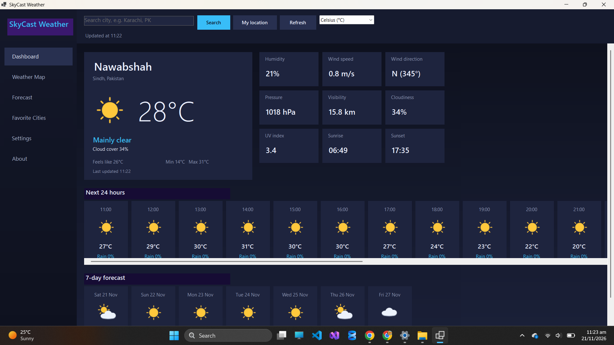
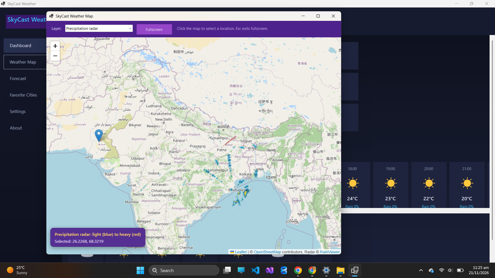
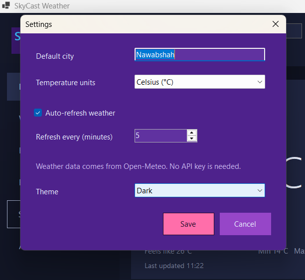

# SkyCast Weather 2.0

A Windows desktop weather dashboard built with C# and .NET 8 (Windows Forms). It shows current conditions, 24-hour and 7-day forecasts, a precipitation radar map, and favorite cities. No API key is required.

## Features

- **Dashboard:** current weather, 9 metric cards, and 24-hour and 7-day forecasts.
- **Search and My location:** search cities by name, or use an approximate IP-based location.
- **Weather Map:** an OpenStreetMap base map with a precipitation radar layer from RainViewer. Click anywhere on the map to load the weather for that point. Favorite cities appear as markers. A fullscreen button is included (press Esc to exit).
- **Favorite Cities:** click "Save city" on the dashboard to save the current location. The Favorites window shows each city's current weather and lets you open or remove it.
- **Settings:** default city, °C or °F, auto-refresh on or off, a refresh interval from 5 to 180 minutes, and a choice of four themes: Colorful, Dark, Light, and Black.

## Screenshots
### Dashboard



### Weather Map



### Settings


## Requirements

- Windows 10 or Windows 11
- Visual Studio 2022 with the ".NET desktop development" workload
- .NET 8 SDK
- Microsoft Edge WebView2 Runtime (already installed on most Windows PCs; otherwise download it from Microsoft)
- An internet connection

## Getting started

1. Clone the repository and open `SkyCastWeather.sln` in Visual Studio 2022.
2. Restore NuGet packages if prompted. This downloads WebView2 and Microsoft.Data.Sqlite.
3. Press **F5** to run.

## Building an EXE

Run this from the repository root:

```
dotnet publish SkyCastWeather\SkyCastWeather\SkyCastWeather.csproj -c Release -r win-x64 --self-contained true -p:PublishSingleFile=true
```

The EXE is created in `SkyCastWeather\SkyCastWeather\bin\Release\net8.0-windows10.0.19041.0\win-x64\publish\`. Keep the `Map` folder next to the EXE, or the map will not load.

## Data sources

| Feature | Service | API key |
|---|---|---|
| Weather, forecasts, UV, visibility | [Open-Meteo](https://open-meteo.com) | Not needed |
| City search | Open-Meteo Geocoding | Not needed |
| "My location" | ipapi.co (approximate) | Not needed |
| Map tiles | [OpenStreetMap](https://www.openstreetmap.org) | Not needed |
| Radar layer | [RainViewer](https://www.rainviewer.com) public API | Not needed |

Open-Meteo's free tier is for non-commercial use. A commercial app needs their paid plan. RainViewer and OpenStreetMap have their own attribution and usage rules, and the map displays the required attribution.

## Project structure

```
SkyCastWeather/                 (repository root)
├── SkyCastWeather.sln
├── screenshots/
└── SkyCastWeather/
    ├── Controls/        Custom UI controls (ForecastTile, MetricCard)
    ├── Data/            SQLite database service
    ├── Forms/           MainForm, MapForm, FavoritesForm, SettingsForm
    ├── Helpers/         App theme, icon helper, configuration
    ├── Map/             index.html, map.js, map.css for the weather map
    ├── Models/          Weather and location models
    ├── Services/        Weather and device location services
    ├── Program.cs
    └── SkyCastWeather.csproj
```

## Files and storage

- Database: `%APPDATA%\SkyCastWeather\skycast.db` (favorites and settings)
- Map page: `Map/index.html`, `Map/map.js`, `Map/map.css` (copied to the output folder on build)

## Customizing the design

Double-click the `.Designer.cs` file for any form, or open the Designer from its `.cs` file. Each form has its own designer. The map's HTML, CSS, and JavaScript are in the `Map/` folder and can be edited directly.

## Roadmap / not included yet

- Temperature, wind, and cloud map layers (their tile services, such as OpenWeatherMap, need an API key)
- Wind-unit settings
- Weather alerts and rain or storm animations


